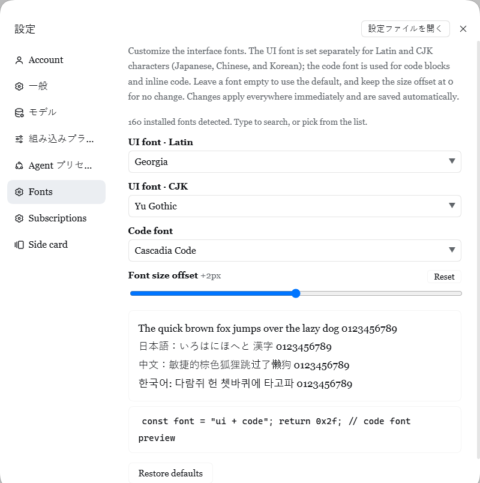

# dsh-custom-fonts

Change the **Latin** and **CJK** UI fonts, the **code font**, and the **text size** of the DeepSeek Harness (DSH) Web UI from a settings page. Changes show up live and are saved automatically.



> A maintained fork of [lsh2002/dsh-custom-fonts](https://github.com/lsh2002/dsh-custom-fonts) that adds settings persistence and an English UI. See [Credits](#credits).

## Features

- **Separate fonts** for Latin text, CJK text (Chinese, Japanese, Korean), and code.
- **Font size offset** from -4 to +8 px, applied evenly to all text.
- **Tight-spacing fix for session titles** (optional, for Safari and the macOS desktop app): WebKit squeezes characters in truncated titles; with this on, titles fade out at the edge instead of ending in "…".
- **Live preview** with Latin, Japanese, Chinese, Korean, and code samples.
- **Installed-font suggestions** in any browser on the computer DSH runs on (including the macOS desktop app), each shown in its own typeface. Fonts that fit the field come first (Japanese/Chinese/Korean fonts for CJK, monospaced fonts for code), with JP/SC/TC/KR/Mono tags. Japanese font names such as 游ゴシック work too.
- **Saved automatically** in your DSH profile and restored after a reload or restart.

## Install

Replace `web` with your DSH profile name (the desktop app uses `desktop`).

```sh
dsh plugin --profile web add github:lifwsp/dsh-custom-fonts
```

Then **restart DSH** once. The plugin needs to be loaded before it can save settings.

> Coming from upstream 1.0 or 1.1? Those versions never saved anything. Run the command above to replace them, restart DSH, and enter your fonts again.

## Usage

1. Open **Settings → Fonts**.
2. Type a font name, pick a suggestion, or enter a comma-separated list such as `Inter, Segoe UI`. An empty field keeps the default font.
3. Installed fonts are listed automatically on the computer DSH runs on. From another device, click **Detect installed fonts** (Chrome and Edge) to use that device's fonts.
4. Move the **Font size offset** slider. `0px` means no change.
5. Use **Restore defaults** to undo everything.

## Troubleshooting

| Symptom | What to do |
| --- | --- |
| The **Fonts** page is missing | Restart DSH after installing, then refresh the page. |
| Changes apply but are lost on reload | Check the status line at the bottom of the page. DSH saves settings only from a local (loopback) connection, and only after restarting once with the plugin installed. |
| "Could not save font settings" | Edit any setting to try again. If it keeps failing, check the entry in `cordis.patch.yml` for a wrong value type. |
| Font name has no effect | Check the spelling, or pick it from the suggestions to see which names are installed. |
| Suggestions show only a few common fonts | The installed-font list needs DSH restarted once after updating the plugin. From another device, use Chrome or Edge and click **Detect installed fonts**. |

For the status messages and the stored format, see [How it works](docs/how-it-works.md).

## Uninstall

```sh
dsh plugin --profile web remove dsh-custom-fonts
```

You can also remove it from **Settings → Plugins**. After a refresh the original fonts return. The saved entry may remain in `cordis.patch.yml`, and you can delete it.

## More

- [How it works](docs/how-it-works.md): saved settings, injected CSS, the size offset, limitations, and status messages.
- [Development](docs/development.md): tests and local setup.
- [Changelog](CHANGELOG.md)

## Credits

- **Original plugin**: [AgustD (@lsh2002)](https://github.com/lsh2002), [lsh2002/dsh-custom-fonts](https://github.com/lsh2002/dsh-custom-fonts).
- **Settings persistence**: [@tom613951](https://github.com/tom613951), [PR #1](https://github.com/lsh2002/dsh-custom-fonts/pull/1).
- **Fork maintenance, English UI, and documentation**: [@lifwsp](https://github.com/lifwsp).

## License

[MIT](LICENSE). Copyright (c) 2026 AgustD.
